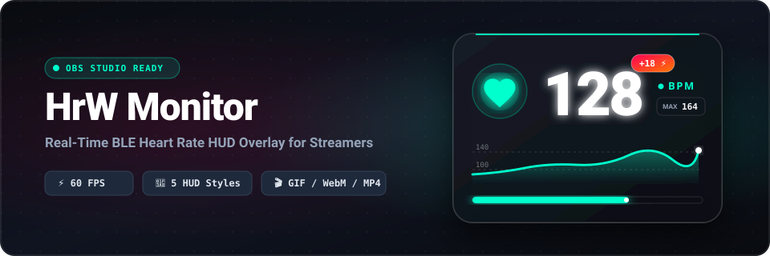
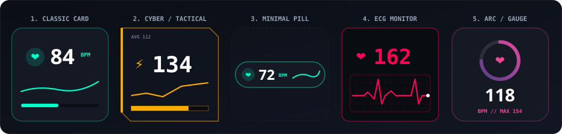

<div align="center">

# ❤️ HrW Monitor

**Локальный HUD-виджет пульса в реальном времени для OBS Studio и стримов**

[](https://www.python.org/)
[](https://fastapi.tiangolo.com/)
[](#поддерживаемые-устройства)
[](#настройка-в-obs-studio)
[](#о-разработке-ai-generated)
[](LICENSE)

<p align="center">
  Лёгкий сервер на базе <b>FastAPI + Bleak</b> с управлением из системного трея Windows, аппаратным ускорением графиков ($60\text{ FPS}$), поддержкой прозрачного видео/анимаций и нулевой нагрузкой на ПК.
</p>

<!-- Изображение 1: Главный баннер проекта -->


</div>

> 🤖 **Дисклеймер от автора репозитория:**
> Этот проект от первой до последней строчки создан с участием ИИ — всю архитектуру, код, стили, математику графиков и даже это описание написала нейросеть под моим руководством. Я выложил его в открытый доступ, потому что виджет получился удобным и рабочим. **Берите, пользуйтесь на здоровье, но вопросы по коду и доработкам мне задавать не надо — там всё делала ИИшка!** 😄

---

## 🎨 5 встроенных форм-факторов (стилей HUD)

<!-- Изображение 2: Витрина всех 5 стилей HUD -->
<p align="center">
  
</p>

Виджет переключается между пятью визуальными макетами налету без перезагрузки сцены в OBS:

| Стиль HUD | Описание | Код для отдельной сцены OBS |
| :--- | :--- | :--- |
| 💎 **Classic Card** | Стеклянная карточка (Glassmorphism) с неоновым свечением, сглаженным сплайн-графиком и шкалой нагрузки | `?obs&layout=classic` |
| ⚡ **Cyber / Tactical** | Тактический угловой интерфейс для динамичных шутеров с эффектом хроматического глитча в высокой зоне пульса | `?obs&layout=cyber` |
| 💊 **Minimal Pill** | Сверхкомпактная однострочная капсула высотой $44\text{ px}$ с мини-графиком для экономии места на экране | `?obs&layout=pill` |
| 📈 **ECG Monitor** | Хоррор / кардиомонитор с процедурной генерацией волны $P\text{-}Q\text{-}R\text{-}S\text{-}T$ на сетке осциллографа | `?obs&layout=ecg` |
| 🎯 **Arc / Gauge** | Круговой спидометр с плавным градиентным кольцом вокруг иконки или пользовательской анимации | `?obs&layout=arc` |

---

## 🔥 Ключевые возможности

### 🎬 Кастомные медиафайлы и умные зоны
* **Поддержка современных форматов (до $15\text{ МБ}$):** загружайте `GIF`, прозрачные видео `WebM` и `MP4`, анимированные `APNG`, `WebP` или статичные `PNG` (проверка файлов происходит по бинарным сигнатурам заголовков).
* **3 режима отображения:**
  1. **Умная смена (Smart):** автоматическое переключение между 3 разными гифками/видео при переходе пульса через пороги зон (*Норма*, *Средний*, *Высокий*).
  2. **Глобальное медиа:** один файл на все зоны пульса.
  3. **Векторное сердце:** встроенная иконка с расходящимися кольцами импульса.
* **Синхронизация с ритмом сердца:** скорость биения иконки и пульсации загруженного медиафайла автоматически подстраивается под текущий пульс по формуле $T = \frac{60}{\text{BPM}}\text{ с}$.

### 🌈 Визуальные эффекты и детектор стресса
* **Color Lerp (плавный градиент):** плавное перетекание цвета между зонами вместо резкого скачка.
* **Анимация цифр Odometer:** вертикальная прокрутка барабана цифр с импульсным увеличением при резком изменении ЧСС ($\ge 5\text{ BPM}$).
* **Стресс-детектор (`+BPM ⚡`):** автоматический анализ скользящего окна за последние $5\text{ секунд}$. При резком скачке пульса выше заданного порога карточка вспыхивает и показывает величину скачка.
* **Процедурный звук сердца (Web Audio API):** реалистичный двухфазный синтез ударов сердца (`lub-dub`) при входе в красную зону без использования внешних аудиофайлов.

### ⚡ Симулятор пульса и память сессии
* **Тестовый режим без датчика:** настраивайте цвета, пороги и анимации с помощью ручного ползунка ($45\text{--}210\text{ BPM}$) или кнопки **«Симуляция клатча ($65 \to 165\text{ BPM}$)»**.
* **Серверная память сессии:** история графика, средний (`AVG`) и максимальный (`MAX`) пульс хранятся на сервере — переключение сцен в OBS не сбрасывает статистику стрима.
* **Экспорт в CSV:** выгрузка полной хронологии сессии (`Timestamp`, `BPM`, `Zone`, `Delta_5s`) в один клик из браузера или меню системного трея.
* **Zero-Lag оптимизация:** когда сцена в OBS неактивна или скрыта, все CSS-анимации и цикл отрисовки `requestAnimationFrame` автоматически ставятся на паузу.

---

## 🚀 Установка и быстрый запуск

### Системные требования
* **ОС:** Windows 10 / Windows 11 ($64\text{-bit}$).
* **Python:** версия $3.11$ или новее ([скачать с python.org](https://www.python.org/downloads/)).
* **Bluetooth:** встроенный или внешний USB Bluetooth Low Energy ($4.0+$) адаптер.

### Запуск в один клик
1. Скачайте репозиторий (или выполните `git clone https://github.com/vanch150/HrW-Monitor.git`).
2. Запустите файл **`start.bat`**.
   * При первом старте скрипт автоматически создаст изолированное окружение `venv/` и установит все зависимости (`fastapi`, `uvicorn`, `bleak`, `websockets`, `pystray`, `pillow`).
   * При последующих запусках `start.bat` мгновенно проверяет целостность библиотек и запускает сервер в фоновом режиме без окна консоли (`pythonw.exe`).
3. В системном трее Windows (около часов) появится иконка сердца:
   * **Серый цвет** — поиск Bluetooth-датчика.
   * **Цвет зоны (бирюзовый / оранжевый / алый)** — датчик подключён, в подсказке отображается текущий и максимальный пульс.
   * **Фиолетовый цвет** — активен режим симулятора.
4. Нажмите правой кнопкой мыши по иконке в трее и выберите **«Открыть настройки в браузере»** (`http://127.0.0.1:8000`).

---

## 🎥 Настройка в OBS Studio

1. Откройте панель настроек виджета в браузере (`http://127.0.0.1:8000`).
2. В самом низу панели нажмите кнопку **«Копировать»** в блоке ссылки для OBS.
3. В **OBS Studio** добавьте новый источник **«Браузер» (Browser Source)**:
   * **URL:** `http://127.0.0.1:8000/?obs`
   * **Ширина (Width):** $1920$
   * **Высота (Height):** $1080$
   * **FPS:** $60$ (при необходимости включите *«Управлять аудио через OBS»*, если используете звук биения сердца в высокой зоне).

> 💡 **Совет для мульти-сцен:** Вы можете использовать разные стили виджета на разных сценах OBS одновременно. Просто укажите в URL источника нужный макет, например: `http://127.0.0.1:8000/?obs&layout=ecg` для хоррор-сцены и `http://127.0.0.1:8000/?obs&layout=pill` для полноэкранного геймплея.

---

## ⌚ Поддерживаемые устройства

Виджет работает с любыми устройствами, передающими пульс по открытому стандарту **Bluetooth GATT Heart Rate Service (`UUID 0x180D`)**:
* **Нагрудные и оптические датчики:** Polar (H9, H10, Verity Sense), Garmin HRM, Magene, Coospo (H6, H808S, HW9), Wahoo TICKR.
* **Фитнес-браслеты и смарт-часы:** Xiaomi Smart Band / Mi Band, Amazfit, Huawei Watch, Samsung Galaxy Watch, Garmin (при включении функции *«Трансляция ЧСС» / Heart Rate Broadcast* в настройках тренировок на часах).

При первом успешном подключении сервер запоминает MAC-адрес устройства и при следующих запусках подключается к нему напрямую за $1\text{--}2\text{ секунды}$.

---

## 📂 Структура проекта

```text
HrW-Monitor/
├── assets/
│   ├── banner.svg              # Главный превью-баннер для README
│   └── layouts_showcase.svg    # Иллюстрация 5 встроенных макетов HUD
├── puls.py                     # Сервер FastAPI, BLE-воркер Bleak, память сессии и иконка трея
├── start.bat                   # Автоматическое развёртывание venv и фоновый лаунчер
├── static/
│   ├── index.html              # Разметка карточки HUD и выдвижной панели настроек
│   ├── style.css               # Стили 5 форм-факторов, анимации и сетка позиционирования
│   └── script.js               # WebSocket-клиент, 60 FPS рендерер графиков/ЭКГ и Web Audio синтезатор
├── .gitignore                  # Исключение локальных конфигов, логов и пользовательских гифок
├── LICENSE                     # Свободная лицензия MIT
└── README.md                   # Документация проекта
```

---

## 🤖 О разработке (AI-Generated)

Весь исходный код проекта, рефакторинг, отладка и документация полностью созданы искусственным интеллектом. Репозиторий предоставляется по принципу **«как есть» (AS IS)** для всех, кому нужен готовый и красивый пульсометр для стримов. Техническая поддержка автором репозитория не оказывается — если хотите что-то переделать под себя, просто скормите файлы своей любимой нейросети!

---

## ⚠️ Отказ от ответственности (Disclaimer)

Данное программное обеспечение разработано исключительно в развлекательных целях для визуального оформления видеотрансляций и стримов. Программа (включая режим визуализации `ECG Monitor` и расчёт стресс-дельты) **не является медицинским прибором** и не предназначена для медицинской диагностики, мониторинга здоровья или лечения.

---

## 📄 Лицензия

Проект распространяется по условиям свободной лицензии **MIT License**. Подробности приведены в файле [LICENSE](LICENSE).